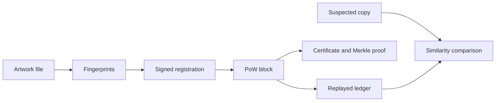

# ArtChain

**A Python experiment in artwork provenance, signed records, and verifiable certificates.**

English | [中文手册](README.zh-CN.md)

ArtChain connects file fingerprints, signed transactions, a local proof-of-work
ledger, and Merkle proofs in one runnable project. Its core runs on the Python
standard library. It includes a CLI, an HTTP API, a browser UI, and an optional
Tkinter desktop interface.

This is an educational prototype maintained by **LanBR-DG**. It has not undergone
an independent security audit. Use test artworks and disposable wallets only.

## Try it locally

Download the source and enter the extracted `artchain` directory. Python 3.8+
is the source compatibility target; local release preparation was tested with
Python 3.12 on Windows. The CI workflow checks additional versions and platforms.

```sh
python -m artchain --data ./data selftest
python -m artchain --data ./data demo
python -m artchain --data ./data serve --open
```

Open <http://127.0.0.1:8080/>. The demo creates sample artwork and disposable
wallets, then demonstrates registration, similarity comparison, transfer,
licensing, disputes, certificates, and chain verification. Its published demo
password is `demo-1234`; these wallets must never hold real assets.

No third-party packages are required for the core workflow. Built-in image
decoding supports PNG and BMP. Pillow is optional for JPEG, WebP, and more formats.
Tkinter must be available in your Python installation to use the desktop UI.

```sh
python -m artchain --help
python -m artchain --data ./data desktop
```

## What is implemented

| Area | Implementation |
| --- | --- |
| Ledger | Proof of work, transaction signatures, Merkle proofs, state replay, peer synchronization |
| Artwork records | Registration, transfer, licensing, disputes, revocation, certificate export |
| Fingerprints | SHA-256, pHash, aHash, dHash, and text SimHash |
| Wallets | secp256k1 signatures, BIP39/BIP32 derivation, encrypted local storage |
| Interfaces | CLI, browser UI/PWA shell, Tkinter UI, HTTP API, Python SDK |
| Other experiments | On-chain posts/likes, platform points, API keys, purchase-order workflows |
| Persistence | Append-only block log, migration, crash-tail recovery |



The included self-test suite has **53 cases in 11 groups**. It checks signatures,
wallet encryption, image fingerprints, Merkle proofs, business flows, points,
mnemonics, API key handling, and storage recovery. This is not a coverage claim
for every HTTP endpoint or browser interaction.

## Development

Run directly from source, or install into a virtual environment:

```sh
python -m pip install .
# Optional image formats:
python -m pip install ".[images]"
```

The installable distribution is named `artchain-provenance`; the Python module
and command are `artchain`. No PyPI publication is implied. When using an
installed package, always select a writable data directory with `--data ./data`.

```sh
python -m artchain --data ./data selftest
python scripts/smoke_http.py
```

The GitHub Actions workflow runs source self-tests on Linux and Windows,
exercises HTTP responses, and checks the wheel in a fresh virtual environment.
See [CONTRIBUTING.md](CONTRIBUTING.md) for the contribution process.

## Boundaries

- A Merkle proof demonstrates inclusion in a particular chain. It does not
  independently establish authorship, real-world identity, or trusted time.
- This is a custom experimental chain; mining is not permission-restricted.
  ArtChain records and points are not Ethereum assets.
- BIP39 word compatibility does not make derivation paths, addresses, or balances
  interchangeable. Never import a real cryptocurrency wallet's seed.
- The built-in HTTP service defaults to loopback and receives wallet secrets.
  Public deployment needs a separate authentication and transport design.
- Purchase orders and region filtering are prototype workflows, not a verified
  payment gateway or a determination of regulatory compliance.
- Runtime data includes wallets and original files. Keep it out of Git.

See [SECURITY.md](SECURITY.md) for details.

## Documentation

- [中文手册](README.zh-CN.md) — commands, features, and examples
- [开放平台 API](开放平台API.md) — API key and SDK usage
- [设计方案](设计方案.md) — original design notes
- [未来开发方向](未来开发方向.md) — original planning notes, not a delivery promise
- [Third-party notices](THIRD_PARTY_NOTICES.md) — BIP39 wordlist provenance

The legal pages under `artchain/web/legal/` are templates with operator
placeholders; they are not customized for a real service or jurisdiction.

## License

Licensed under the [MIT License](LICENSE). Copyright (c) 2026 LanBR-DG.
Third-party material retains its own notices. See [THIRD_PARTY_NOTICES.md](THIRD_PARTY_NOTICES.md).
